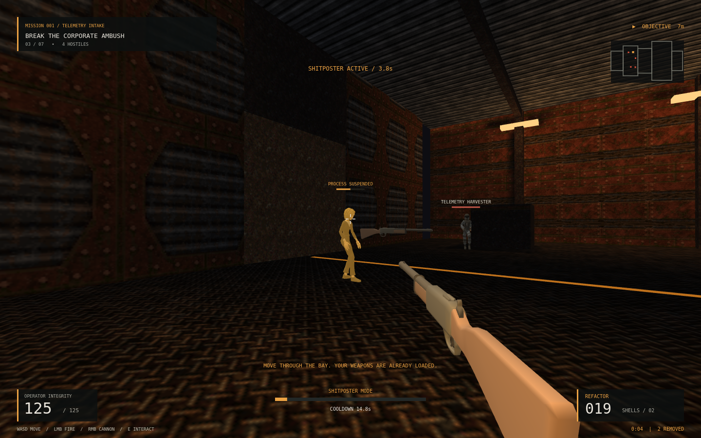

# QSOL-IMC: BLOAT-OPS

[](https://github.com/QSOLKCB/BLOAT-OPS/actions/workflows/check.yml)


**Eliminate corporate inefficiency with extreme prejudice.**

An original single-player browser FPS about one independent researcher and an industry that needs 32 GB to open a text file. Built with vanilla JavaScript, WebGL2 and adapted [QwakeTF](https://github.com/QSOLKCB/QwakeTF) engine systems. No accounts, telemetry, CDN or backend.



**Mission 001: The Dependency Factory.** Infiltrate five industrial sectors, recover SHITPOSTER firmware, isolate two relays, shut down the BLOAT Core, survive three restructuring waves and extract. Fight fast Telemetry Harvesters and armoured Middleware Managers using the Dependency Remover rifle and explosive Refactor Cannon. SHITPOSTER MODE actually interrupts and stuns nearby visible enemies, then lets them recover.

```sh
node tools/serve.mjs
# Open http://127.0.0.1:8080/
```

Desktop browser with WebGL2, keyboard and mouse required. **WASD** move; **mouse** aim; **Space** jump; **Shift** sprint; **LMB** fire; **RMB** cannon; **1/2** select; **Q** precision aim; **F** SHITPOSTER; hold **E** interact; **Esc** pause. Settings include sensitivity, FOV, audio, ability key and reduced effects.

For one-file offline play, run `node tools/build.mjs` and open `dist/BLOAT-OPS-standalone.html`. Source `index.html` redirects to that built file when opened from disk.

GitHub Pages target: <https://qsolkcb.github.io/BLOAT-OPS/>. Deployment is configured for tested, maintainer-merged **main** only; this PR does not establish a live deployment.

[Getting started](GETTING_STARTED.md) · [Player instructions](INSTRUCTIONS.md) · [Architecture](ARCHITECTURE.md) · [Asset licences](ASSET_LICENSES.md) · [Verification](docs/VERIFICATION.md) · [Proposed release notes](RELEASE_NOTES.md) · [Roadmap](ROADMAP.md)

**Correctness outranks speed. Bloatware is the enemy.**
